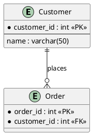

# ER Diagram Validator

## Overview

A command-line tool that reads a PlantUML ER diagram, checks it against a set of design rules, and prints the violations it finds. Two presets control which rules run:

- **lenient**: core key and relationship consistency rules (R1 to R4)
- **strict**: the lenient rules plus stricter checks (R5, R6, and any optional rules we finish)

The tool is evaluated on valid diagrams and on diagrams with one deliberately injected error each, comparing how the two presets do.

How it works:

```
diagram.puml --> parser --> DiagramModel --> enabled rules --> violations --> printed + PASS/FAIL
                                               ^
                                      preset (configs/*.yaml)
```

## Project status

Update this checklist as pieces land. Put your name next to anything you claim.

**To do (checked = done)**
- [x] `validator/model.py`: shared data classes (do not change without team agreement)
- [x] `validator/parser.py`: PlantUML text to model
- [x] `validator/writer.py`: model to PlantUML text (round-trips with the parser)
- [x] Rule definitions and strict/lenient configurations
- [ ] YAML config loader: read a preset, check every enabled ID exists in `rules.yaml` and in the registry, return the list of IDs (owner: ___)
- [ ] Rules R1 to R6, one file each in `validator/rules/`, plus the registry (owner: ___)
- [ ] `validator/validate.py`: run the enabled rules on a model and return the violations (owner: ___)
- [ ] `validator/cli.py` and `__main__.py`: command-line entry point (owner: ___)
- [ ] Tests: parser tests and one test file per rule in `tests/` (owner: ___)
- [ ] `tools/generate_diagrams.py`: generate valid diagrams (owner: ___)
- [ ] `tools/inject_errors.py`: mutate valid diagrams and write ground truth (owner: ___)
- [ ] `tools/evaluate.py`: run both presets on all data and report which tests passed and failed (owner: ___)
- [ ] A few handwritten diagrams in `data/samples/` (owner: ___)
- [ ] Optional rules R7 to R11, only if time allows (owner: ___)
- [ ] Finish this README: fill in the real CLI flags, remove unused dependencies from `requirements.txt` (owner: ___)

Suggested order: rules and tests only need `model.py` and `parser.py`, so they can start now. The generator and mutator need `writer.py` (done). `evaluate.py` needs everything else.

## Input format

Input is one PlantUML ER diagram per file, using a defined subset of syntax. Anything outside the subset raises a `ParseError` with a 1-based line number.

- Wrapper: `@startuml` ... `@enduml`
- Ignored: lines starting with `'` (comments), and `title`, `skinparam`, `hide`, `show`, and layout direction lines
- Entities: `entity Name { ... }` or `entity Name {}`
- Attributes: `[*] name : type [<<PK>>] [<<FK>>]`. A leading `*` means mandatory. `--` lines are ignored. Stereotypes can be separate (`<<PK>> <<FK>>`) or comma-separated (`<<PK, FK>>`).
- Relationships: `Left <left><right> Right [: label]` using crow's-foot symbols, joined by `--` (or `..`)

| Cardinality | Left end | Right end |
|---|---|---|
| Exactly one | `\|\|` | `\|\|` |
| Zero or one | `\|o` | `o\|` |
| One or more | `}\|` | `\|{` |
| Zero or more | `}o` | `o{` |

Example:



Things to know about the parser:
- PlantUML does not say which PK an FK points to, so the parser fills in `Attribute.references` (as `"Entity.pk_name"`) by matching an FK's name to a PK name on a connected entity. Self-relationships are skipped. An FK with no match keeps `references = None`.
- Duplicate entity names raise a `ParseError`. Duplicate attribute names inside an entity are not rejected (rule R11 covers them).
- `..` lines are read as `--`; the model does not store the line style.

## Install

Requires Python 3.12 or newer (the model uses `typing.override`).

```
python -m venv .venv
source .venv/bin/activate
pip install -r requirements.txt
```

## Usage

Intended behavior (final flag names are decided when `cli.py` is written):

```
python -m validator path/to/diagram.puml --preset strict
```

Output is one line per violation, then a verdict:

```
[ERROR] R1  Entity "Order" has no primary key
[ERROR] R4  Order.customer_id is varchar(20) but references Customer.customer_id (int)
FAIL (2 violations)
```

- Each violation line comes from `Violation.__str__`: `[SEVERITY] RULE_ID  message`.
- A diagram with no violations prints `PASS`.
- Proposed exit codes: `0` PASS, `1` FAIL, `2` input error (file missing or `ParseError`).
- `--preset` chooses `lenient` or `strict`, and the default is `strict`.
- Output is the command line only. There is no JSON report, no annotated PlantUML, and no UI.

## Rules

A **relationship is one-to-many** if exactly one end is many. The many-end entity is the **child** (holds the FK); the other is the **parent**. An FK's target PK is `fk.references`.

| ID | Rule | Preset |
|---|---|---|
| R1 | **Missing primary key.** Entity has no `<<PK>>` attribute. | lenient + strict |
| R2 | **FK on the wrong side.** In a one-to-many relationship, the parent holds an FK that references a PK of the child. | lenient + strict |
| R3 | **FK/relationship mismatch.** (a) A relationship (not many-to-many) where neither entity has an FK referencing the other, or (b) an FK whose `references` is `None`. Direction is ignored; R2 owns that. | lenient + strict |
| R4 | **FK type mismatch.** FK type differs from the PK it references (ignore case and spaces). Skip FKs with no `references`. | lenient + strict |
| R5 | **Many-to-many with no junction.** A relationship where both ends are many. | strict |
| R6 | **Mandatory cycle.** A requires B if the marker at B's end is mandatory (`\|\|`, `}\|`, `\|{`). Flag each cycle of requirements, including a self-relationship with a mandatory end. | strict |
| R7 | *(optional)* **FK marker contradicts relationship.** For an FK in the child of a one-to-many: parent end `\|\|` means the FK needs `*`; parent end `\|o` means it must not have `*`. | strict |
| R8 | *(optional)* **Duplicate relationship.** Two relationships between the same two entities with identical cardinalities (either direction). | strict |
| R9 | *(optional)* **Orphan entity.** Entity in no relationship (only when the diagram has 2 or more entities). | strict |
| R10 | *(optional)* **PK not mandatory.** PK attribute without the `*` marker. | strict |
| R11 | *(optional)* **Duplicate attribute name.** Two attributes with the same name in one entity. | strict |

The same information lives in `configs/rules.yaml`, which is the source for severities.

### Adding a rule

- One file per rule in `validator/rules/`, for example `r1_missing_pk.py`.
- A rule is a function that takes a `DiagramModel` and returns a `list[Violation]` (`rule_id`, `severity`, `target`, `message`).
- Register it in the registry (a dict from rule ID to function) so `validate.py` can look it up.
- Enable it by adding its ID to `enabled` in a preset file.
- Add a test file in `tests/` that builds models directly in Python instead of reading `.puml` files.

### Config files

- `configs/rules.yaml`: catalog of all rules (`id`, `name`, `description`, `severity`, `optional`, `mutation`). The loader can ignore `mutation`; only `tools/inject_errors.py` uses it.
- `configs/lenient.yaml` and `configs/strict.yaml`: `name`, `description`, and `enabled` (a list of rule IDs).

## Reproducing the experiments

All three scripts live in `tools/`. Exact arguments are decided when they are written.

1. `generate_diagrams.py` writes valid diagrams to `data/valid/`.
2. `inject_errors.py` takes valid diagrams, injects one error each, and writes the mutated diagrams plus ground truth (which rule each mutation should trigger) to `data/mutated/`.
3. `evaluate.py` runs both presets on all the data and reports which tests passed and which failed.

**Proposed pass criteria**
- A valid diagram passes if both presets report zero violations.
- A mutated diagram passes under a preset that enables the intended rule if exactly that rule fires, and nothing else.
- A mutated diagram passes under a preset that does not enable the intended rule if it reports no violations. This is the expected lenient-vs-strict difference: lenient does not catch R5 and above.

### Valid diagram constraints (for the generator)

These keep valid diagrams free of violations and keep each mutation to a single violation.

- 2 or more entities; entity names unique; attribute names unique within an entity
- Relationships form a tree (ignoring direction): no cycles, no self-relationships, at most one relationship per pair of entities
- Only one-to-many relationships: one end `||` or `|o`, many end `o{`
- Each entity has one PK attribute, marked `*`, with a name unique across the diagram (for example `customer_id`)
- A child has one FK per relationship, with the same name and type as the parent's PK; the FK has `*` only if the parent end is `||`
- Many-to-many only through a junction entity: two `||` relationships, its PK is its two FKs (both `*`), and it is never a parent
- Include some of each: non-PK FKs, junctions, and plain (non-key) attributes, so every mutation has something to hit

### Mutations (for the mutator)

| Rule | Mutation |
|---|---|
| R1 | Strip `<<PK>>` from an entity that is not the parent in any relationship |
| R2 | Swap the two cardinality ends of a relationship (`\|\|--o{` becomes `}o--\|\|`) |
| R3 | Delete the non-PK FK of a relationship, or delete a relationship whose two entities both keep another relationship |
| R4 | Change one FK's type to a different type |
| R5 | Replace a junction entity and its two relationships with a direct `A }o--o{ B` (not `}\|--\|{`, which would also fire R6) |
| R6 | Change `o{` to `\|{` on a relationship whose one end is `\|\|` |
| R7 | Toggle `*` on a non-PK FK |
| R8 | Copy a relationship line |
| R9 | Add a new entity with only a `*` PK and no relationships |
| R10 | Remove `*` from a PK that is not also an FK |
| R11 | Copy a plain (non-key) attribute inside its entity |

Safety net: after mutating, run all rules and keep the diagram only if exactly the intended rule fires.

## Project layout

| Path | Purpose |
|---|---|
| `validator/` | The tool: `model.py`, `parser.py`, `writer.py`, `validate.py`, `cli.py`, `__main__.py` |
| `validator/rules/` | One rule per file, plus the registry |
| `configs/` | Rule catalog and the lenient and strict presets (YAML) |
| `tools/` | Experiment scripts: generate, mutate, evaluate |
| `data/samples/` | A few handwritten sample diagrams |
| `data/valid/` | Generated valid diagrams |
| `data/mutated/` | Mutated diagrams and ground truth |
| `results/` | Evaluation output |
| `tests/` | Parser tests and one test file per rule |

## Open decisions

- Does PASS/FAIL depend on severity (for example only `ERROR` fails and `WARN` is printed), or does any violation fail?
- Where does a rule get its severity: hard-coded in the rule, or looked up from `rules.yaml`?
- Format and location of the ground truth written by `inject_errors.py`.
- Final CLI flag names and the default preset.
- Whether `evaluate.py` exits non-zero when any test fails.
- Drop `matplotlib` and `pandas` from `requirements.txt` if there are no charts.